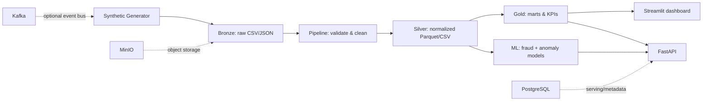

# NEXUS — Financial Data Intelligence Platform

A portfolio-grade, end-to-end financial data platform demonstrating data engineering, analytics engineering, machine learning, APIs, data quality, and observability concepts. **All data is synthetic.**

## What it does
- Generates realistic synthetic banking transactions, customers, accounts, merchants, and labeled fraud cases.
- Runs a reproducible batch pipeline: **Bronze → Silver → Gold** (CSV + Parquet where supported).
- Performs validation and data-quality reporting.
- Trains a fraud classifier and an unsupervised anomaly detector; reports precision, recall, F1, ROC-AUC (when available), and PR-AUC.
- Exposes metrics and predictions through a FastAPI service.
- Includes a Streamlit analytics dashboard.
- Provides Docker Compose infrastructure for PostgreSQL, MinIO, Kafka (KRaft), API, and dashboard.

## Architecture


## Quick start (Python)
Requires Python 3.10+.

```bash
python -m venv .venv
# Windows:
.venv\Scripts\activate
# Linux/macOS:
source .venv/bin/activate
pip install -r requirements.txt
python -m nexus.cli run --rows 100000
```
This creates artifacts in `data/` and model outputs in `artifacts/`.

Start the API:
```bash
uvicorn nexus.api:app --reload --port 8000
```
Docs: http://localhost:8000/docs

Start the dashboard:
```bash
streamlit run dashboard/app.py
```

## Docker
```bash
docker compose up --build -d
docker compose ps
```
API: http://localhost:8000/docs  
Dashboard: http://localhost:8501  
MinIO console: http://localhost:9001 (nexusadmin / nexuspassword123)  
Kafka broker: localhost:9092  
PostgreSQL: localhost:5432 (nexus / nexus / nexus_dev_password)

Run pipeline in the app container:
```bash
docker compose exec api python -m nexus.cli run --rows 100000
```
Stop:
```bash
docker compose down
```
Remove persistent data (destructive):
```bash
docker compose down -v
```

## Pipeline outputs
| Path | Contents |
|---|---|
| `data/bronze/transactions.csv` | Generated raw transactions |
| `data/bronze/customers.csv` | Synthetic customer profiles |
| `data/bronze/accounts.csv` | Accounts |
| `data/silver/transactions.parquet` | Cleaned transaction table (CSV fallback if parquet engine absent) |
| `data/silver/transactions.csv` | Cleaned records |
| `data/gold/daily_metrics.csv` | Daily KPIs |
| `data/gold/customer_metrics.csv` | Customer aggregation |
| `data/gold/fraud_segments.csv` | Risk segmentation |
| `artifacts/quality_report.json` | Quality checks |
| `artifacts/model_metrics.json` | Model metrics |
| `artifacts/fraud_model.joblib` | Supervised model |
| `artifacts/anomaly_model.joblib` | Isolation Forest |
| `artifacts/scored_transactions.csv` | Model scores |

## Example CLI
```bash
python -m nexus.cli generate --rows 250000 --seed 42
python -m nexus.cli pipeline
python -m nexus.cli train
python -m nexus.cli run --rows 100000 --seed 42
```

## API endpoints
- `GET /health`
- `GET /metrics`
- `GET /analytics/overview`
- `GET /analytics/daily`
- `GET /transactions?limit=50`
- `GET /fraud/alerts?threshold=0.65&limit=50`
- `POST /fraud/predict` (request body shown in Swagger)

## Data quality
Checks include null rate, duplicate transaction IDs, non-positive amounts, invalid timestamps, foreign-key consistency, and fraud label bounds. The pipeline writes a JSON report and exits with an error only for critical failures.

## Project layout
```text
nexus/
  generator.py     synthetic data generation
  pipeline.py      bronze/silver/gold transformations
  quality.py       checks and report
  modeling.py      supervised + unsupervised modeling
  api.py           FastAPI serving layer
  cli.py           command-line orchestration
dashboard/
  app.py           Streamlit dashboard
tests/
  test_pipeline.py
  test_generator.py
```

## Important portfolio disclaimer
This project is an educational simulation. It does not use real customer data, connect to banking systems, or provide financial/fraud decisions. Synthetic labels are intentionally created by the generator and may make metrics optimistic. Use a temporal split and evaluate drift before treating a model as production-ready.

## Roadmap
- [ ] Kafka live event producer/consumer and streaming windowed aggregations
- [ ] Spark implementation for distributed batch processing
- [ ] dbt models and tests
- [ ] Airflow DAG orchestration
- [ ] Great Expectations integration
- [ ] Prometheus/Grafana dashboards
- [ ] CI pipeline and automated image publishing
- [ ] Cloud deployment (AWS: S3, Glue, EMR, Redshift)

## License
MIT. See `LICENSE`.
